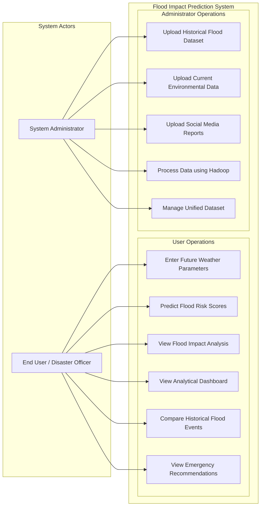

# System Architecture & Technical Specifications

## 1. High-Level Architecture Overview

The system bridges big data engineering (Hadoop ecosystem) with domain-specific disaster risk analytics and interactive reporting.

```mermaid
flowchart TD
    subgraph DataSources["Multi-Source Data Ingestion (1.1M+ Records)"]
        D1["Historical Records (500k)\n(IMD, CWC, KSDMA)"]
        D2["Current Environmental (250k)\n(Weather & River Sensor APIs)"]
        D3["Social Media & Feeds (350k)\n(X/Twitter, Helplines, Reddit)"]
    end

    subgraph ETL["ETL & Standardization Layer"]
        E1["Data Cleansing & Filtering"]
        E2["Spatial-Temporal Alignment"]
        E3["Unified 32-Column Schema Master File"]
    end

    subgraph HadoopEngine["Hadoop Big Data Core"]
        H1["Hadoop Distributed File System (HDFS)\n/data/kerala_flood/master/"]
        H2["MapReduce Processing Engine\n- District Aggregation\n- Trend Mining & Normalization"]
        H3["Apache Hive Metastore\nSQL-like Analytical Queries"]
    end

    subgraph IntelligenceLayer["Analytics & Assessment Engine"]
        A1["Weighted Risk Prediction Engine\n(Rainfall 30%, River 25%, History 20%, etc.)"]
        A2["Impact Prediction Module\n(Pop. Exposed, Infrastructure Loss, Priority Tier)"]
    end

    subgraph PresentationLayer["Interactive Dashboard & UI"]
        UI1["District Risk Rankings & Heatmaps"]
        UI2["What-If Weather Parameter Simulation"]
        UI3["Historical Event Comparison"]
        UI4["Emergency Priority & Resource Allocator"]
    end

    DataSources --> ETL
    ETL --> H1
    H1 --> H2
    H2 --> H3
    H3 --> IntelligenceLayer
    IntelligenceLayer --> PresentationLayer
```

---

## 2. Actor & Use-Case Architecture

---

## 3. Big Data Processing Workflow (MapReduce Pipeline)

### Phase 1: Mapper Phase
- **Input:** Unified CSV/Parquet records from HDFS (`Record_ID, Timestamp, District, Rainfall_mm, River_Level_m, Population, ...`).
- **Processing:** Validates boundaries, strips null anomalies, and outputs key-value pairs grouped by district:
  $$\text{Key} = \text{District}, \quad \text{Value} = (\text{Rainfall}, \text{RiverLevel}, \text{HistoryFreq}, \text{PopDensity}, \text{CitizenReports})$$

### Phase 2: Combiner & Shuffle Phase
- In-memory local aggregation and sorting across DataNodes to minimize network traffic across Hadoop cluster racks.

### Phase 3: Reducer Phase
- **Processing:** District-level summation, rolling averages, maximum peak watermarks, and historical recurrence indexing.
- **Output:** Summarized district feature vectors loaded into Hive tables: `kerala_flood_features`.

---

## 4. Architectural Component Descriptions

| Module | Purpose | Technologies |
|---|---|---|
| **Data Ingestion Module** | Batch & streaming ingestion of past records, live APIs, and scraped social text | Python (Requests, Tweepy), Flume |
| **Storage Layer** | Distributed, fault-tolerant replication of 1.1M+ master records | Hadoop HDFS (Block size: 128MB, Rep: 3) |
| **Compute Engine** | Massively parallel aggregation and feature vector extraction | Hadoop MapReduce (Java/Python Streaming) |
| **Query Engine** | Ad-hoc analytics and district summary generation | Apache Hive |
| **Scoring & Prediction** | Multi-attribute weighted risk and impact matrix evaluation | Python / PySpark computation service |
| **Web Dashboard** | Responsive visualization for disaster officials and public | Streamlit / React + FastAPI, Leaflet/MapLibre |
