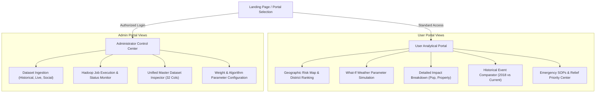

# UI/UX Specifications & Interface Architecture

## 1. Design System & Principles
- **Emergency-First Ergonomics:** Instant visual clarity under crisis scenarios; high-contrast warning indicators (Green, Yellow, Orange, Red).
- **Responsive Layout:** Compatible with desktop command centers (Disaster Control Rooms) and field tablet devices.
- **Explainable Metrics:** Every risk number has an expandable tooltip breaking down contributing weights (Rainfall, River, History, Geography, Population, Social).

---

## 2. Navigation & User Journey



---

## 3. Screen Wireframes & UI Specifications

### Screen 1: Executive District Risk & Analytical Dashboard (User)
```
+--------------------------------------------------------------------------------------------------+
|  KERALA FLOOD RISK PREDICTION & IMPACT ANALYSIS SYSTEM                     [ Live Alert: RED ]  |
+--------------------------------------------------------------------------------------------------+
| [District Selector: Alappuzha v]  [Date: 09-Oct-2026]                    [Download Report (PDF)] |
+----------------------------------------------------+---------------------------------------------+
|  GEOSPATIAL RISK HEATMAP                          |  DISTRICT RISK RANKING                      |
|                                                    |  1. Alappuzha    88.5/100  [CRITICAL]  🔴  |
|   [ Kerala Interactive Map ]                       |  2. Idukki       82.0/100  [CRITICAL]  🔴  |
|   - Red zones: Low-lying coastal & river basins    |  3. Kottayam     65.4/100  [HIGH]      🟠  |
|   - Orange zones: Hill slope landslide/flood       |  4. Pathanamthitta 61.2/100 [HIGH]      🟠  |
|   - Green zones: Northern highland plateau         |  5. Kollam       39.8/100  [MODERATE]  🟡  |
+----------------------------------------------------+---------------------------------------------+
|  WHAT-IF PARAMETER SIMULATOR                       |  IMPACT ASSESSMENT & EMERGENCY DISPATCH     |
|  Rainfall (mm):     [=====O=====] 420 mm           |  - Est. Affected Population : 142,000       |
|  River Water Gauge: [=======O===] +2.8 m above DM  |  - Inundated Residential Dwellings : 38,500 |
|  Dam Outflow (%):   [====O======] 85%              |  - Infrastructure Damage Index : 84/100     |
|  [ CALCULATE PREDICTION ]                          |  - Emergency Response Priority : LEVEL 1   |
|  Result: Risk Score: 88.5 -> CRITICAL              |  Action: Immediate NDRF deployment to Kuttanad|
+----------------------------------------------------+---------------------------------------------+
```

### Screen 2: Big Data Administration & Hadoop Job Monitor (Admin)
```
+--------------------------------------------------------------------------------------------------+
|  HADOOP CLUSTER & DATA INGESTION MANAGEMENT (ADMIN)                     Cluster: HEALTHY (3 Nodes)|
+--------------------------------------------------------------------------------------------------+
|  DATA INGESTION DROPZONES                                                                        |
|  [ 📂 Upload Historical Data (CSV) ]   [ 🌐 Sync Live Weather API ]   [ 📱 Scrape Social Media ] |
|  Records Loaded: 500,000                Records Loaded: 250,000         Records Loaded: 350,000   |
+--------------------------------------------------------------------------------------------------+
|  UNIFIED DATASET CONSOLIDATION                                                                   |
|  Master Records: 1,100,000+ Records | HDFS Path: /data/kerala_flood/master/flood_unified.parquet |
|  Status: Cleaned, Deduplicated, Schema Validated (32 Attributes)                                 |
+--------------------------------------------------------------------------------------------------+
|  HADOOP MAPREDUCE JOB RUNNER                                                                     |
|  Job ID: job_1728461829_0012   |  Job Name: DistrictMetricAggregationMapperReducer               |
|  Map Progress:   [====================] 100%                                                     |
|  Reduce Progress:[====================] 100%                                                     |
|  Execution Time: 3m 42s         | Data Processed: 4.8 GB          [ RE-RUN BATCH JOB ]           |
+--------------------------------------------------------------------------------------------------+
```

---

## 4. UI Color Palette & Token Hierarchy
- **Critical Risk (Red):** `#DC2626` / Alert Red (Action: Immediate Evacuation)
- **High Risk (Orange):** `#EA580C` / Amber Orange (Action: Pre-stage rescue camps)
- **Moderate Risk (Yellow):** `#EAB308` / Warning Gold (Action: River gauge surveillance)
- **Low Risk (Green):** `#16A34A` / Safe Emerald (Action: Regular monitoring)
- **Primary Interface Background:** `#F8FAFC` (Slate 50)
- **Cards & Surfaces:** `#FFFFFF` (Pure White) with subtle `#E2E8F0` borders
- **Text & Headings:** `#0F172A` (Slate 900)
